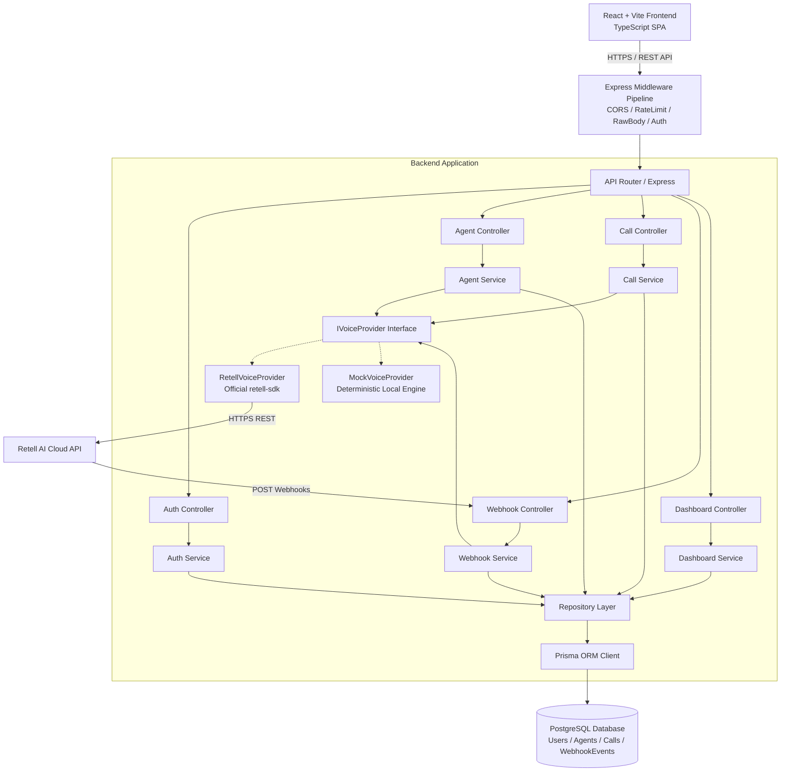

# System Architecture & Technical Design Blueprint

**Project:** AI Voice Agent Management System  
**Organization:** Shiavnski Technologies Developer Assignment  
**Architect:** Senior Full-Stack Architect  
**Tech Stack:** React (Vite + TypeScript) | Node.js + Express (TypeScript) | PostgreSQL | Prisma ORM | Retell AI  
**Status:** Approved for Implementation  

---

## 1. High-Level Architectural Overview

The system is architected as a decoupled, multi-tier TypeScript application comprising:
1. **Frontend Presentation Tier (`/frontend`)**: A React 18 single-page application built with Vite, TypeScript, and a modern custom CSS design system offering dashboard metrics, agent management, an outbound call console, and call history with rich transcript/recording players.
2. **Backend Application Tier (`/backend`)**: A modular Node.js + Express REST API written in strict TypeScript, structured into strict horizontal layers (Routes -> Controllers -> Services -> Repositories -> Prisma Client).
3. **Data Persistence Tier (`PostgreSQL`)**: A normalized 3NF relational database managed with Prisma ORM and migrations, enforcing strict foreign key constraints, unique constraints, and performance indexes.
4. **Provider Abstraction Tier (`IVoiceProvider`)**: A clean dependency-inverted telephony abstraction layer allowing hot-swapping between `RetellVoiceProvider` (live Retell AI SDK) and `MockVoiceProvider` (local deterministic simulation for zero-credential evaluation).



---

## 2. Directory Structure & Workspace Layout

The workspace is organized as a clean, cohesive monorepo or dual-package structure:

```
SHIAVNSKI/
├── docs/
│   ├── REQUIREMENTS_CHECKLIST.md
│   ├── RETELL_INTEGRATION_NOTES.md
│   ├── ARCHITECTURE.md
│   ├── DATABASE_DESIGN.md
│   ├── IMPLEMENTATION_PLAN.md
│   └── TEST_PLAN.md
├── backend/
│   ├── prisma/
│   │   ├── schema.prisma             # Data models, relations, indexes
│   │   ├── migrations/               # Version-controlled SQL migrations
│   │   └── seed.ts                   # Demo seed data (users, agents, sample calls)
│   ├── src/
│   │   ├── config/                   # Validated environment variables (Zod)
│   │   ├── controllers/              # HTTP request/response handlers
│   │   │   ├── auth.controller.ts
│   │   │   ├── agent.controller.ts
│   │   │   ├── call.controller.ts
│   │   │   ├── webhook.controller.ts
│   │   │   └── dashboard.controller.ts
│   │   ├── middleware/               # Express middlewares
│   │   │   ├── auth.middleware.ts      # JWT validation & user injection
│   │   │   ├── validate.middleware.ts  # Zod schema validation
│   │   │   ├── rawBody.middleware.ts   # Raw request body capture for HMAC
│   │   │   ├── error.middleware.ts     # Centralized error handler
│   │   │   └── rateLimit.middleware.ts # Anti-abuse rate limiting
│   │   ├── services/                 # Core business logic
│   │   │   ├── auth.service.ts
│   │   │   ├── agent.service.ts
│   │   │   ├── call.service.ts
│   │   │   ├── webhook.service.ts
│   │   │   └── dashboard.service.ts
│   │   ├── repositories/             # Direct Prisma DB access queries
│   │   │   ├── user.repository.ts
│   │   │   ├── agent.repository.ts
│   │   │   ├── call.repository.ts
│   │   │   └── webhook.repository.ts
│   │   ├── providers/                # Voice provider abstraction
│   │   │   ├── voice-provider.interface.ts # IVoiceProvider contract
│   │   │   ├── retell.provider.ts          # Real Retell SDK implementation
│   │   │   ├── mock.provider.ts            # Realistic simulation engine
│   │   │   └── index.ts                    # Factory resolving provider by config
│   │   ├── schemas/                  # Zod input validation schemas
│   │   │   ├── auth.schema.ts
│   │   │   ├── agent.schema.ts
│   │   │   ├── call.schema.ts
│   │   │   └── webhook.schema.ts
│   │   ├── types/                    # Shared backend TypeScript types
│   │   │   ├── auth.types.ts
│   │   │   ├── provider.types.ts
│   │   │   └── express.d.ts
│   │   ├── utils/                    # Encryption, phone formatting, logger
│   │   │   ├── jwt.util.ts
│   │   │   ├── password.util.ts
│   │   │   ├── phone.util.ts
│   │   │   └── logger.ts
│   │   ├── app.ts                    # Express application builder
│   │   └── server.ts                 # Server entry point & graceful shutdown
│   ├── tests/                        # Automated test suites
│   │   ├── unit/                     # Utility and service unit tests
│   │   ├── integration/              # Supertest API endpoint tests
│   │   └── fixtures/                 # Mock payloads and headers
│   ├── .env.example
│   ├── tsconfig.json
│   └── package.json
├── frontend/
│   ├── public/                       # Static brand assets & icons
│   ├── src/
│   │   ├── api/                      # Typed Axios / Fetch HTTP client
│   │   │   ├── client.ts             # Interceptors for auth and error toast
│   │   │   ├── auth.api.ts
│   │   │   ├── agent.api.ts
│   │   │   ├── call.api.ts
│   │   │   └── dashboard.api.ts
│   │   ├── components/               # Reusable UI components
│   │   │   ├── layout/               # Header, Sidebar, Container
│   │   │   ├── common/               # Button, Modal, Badge, Skeleton, Input
│   │   │   ├── dashboard/            # MetricCard, RecentCallsTable, TrendChart
│   │   │   ├── agent/                # AgentCard, AgentFormModal, DeleteConfirmModal
│   │   │   ├── call/                 # OutboundCallForm, AudioPlayer, TranscriptViewer
│   │   │   └── dev/                  # WebhookSimulatorPanel (Mock helper)
│   │   ├── context/                  # AuthContext, NotificationContext
│   │   ├── hooks/                    # Custom React hooks (useAuth, useCalls, useDebounce)
│   │   ├── pages/                    # Route page components
│   │   │   ├── LoginPage.tsx
│   │   │   ├── RegisterPage.tsx
│   │   │   ├── DashboardPage.tsx
│   │   │   ├── AgentsPage.tsx
│   │   │   ├── AgentDetailPage.tsx
│   │   │   ├── CallsPage.tsx
│   │   │   ├── CallDetailPage.tsx
│   │   │   └── NewCallPage.tsx
│   │   ├── styles/                   # Modern CSS system & theme variables
│   │   │   ├── index.css
│   │   │   ├── variables.css
│   │   │   └── components.css
│   │   ├── types/                    # Shared frontend interfaces
│   │   ├── utils/                    # Date formatting, phone masking
│   │   ├── App.tsx                   # Route definitions & guards
│   │   └── main.tsx                  # React entry point
│   ├── .env.example
│   ├── index.html
│   ├── tsconfig.json
│   ├── vite.config.ts
│   └── package.json
└── README.md
```

---

## 3. Layered Backend Design Patterns

### 3.1 Controller-Service-Repository Separation
Each layer maintains single responsibility:
- **Controllers**: Parse and validate HTTP inputs using Zod; invoke services; map service outputs or domain errors to standard HTTP status codes. Never run direct SQL or database operations.
- **Services**: Implement core business rules (e.g. verify agent ownership before initiating call, execute duplicate call protection, orchestrate provider dispatch, trigger webhook state machine).
- **Repositories**: Encapsulate all database queries via Prisma Client. Allow mocking the database layer in unit tests without touching a real Postgres instance.
- **Provider Layer**: Encapsulates all third-party telephony integrations behind a standardized interface.

### 3.2 Provider Abstraction Pattern (`IVoiceProvider`)
Business logic never imports `retell-sdk` directly. Instead, services depend on `IVoiceProvider`:

```typescript
export interface IVoiceProvider {
  createAgent(params: CreateAgentParams): Promise<ProviderAgentResult>;
  getAgent(providerAgentId: string): Promise<ProviderAgentDetails>;
  updateAgent(providerAgentId: string, params: UpdateAgentParams): Promise<ProviderAgentResult>;
  deleteAgent(providerAgentId: string): Promise<void>;
  createPhoneCall(params: CreateCallParams): Promise<ProviderCallResult>;
  getCallDetails(providerCallId: string): Promise<ProviderCallDetails>;
  verifyWebhookSignature(rawBody: string | Buffer, signature: string): Promise<boolean>;
}
```

#### Provider Factory:
```typescript
export function getVoiceProvider(): IVoiceProvider {
  if (config.PROVIDER_MODE === 'retell') {
    return new RetellVoiceProvider(config.RETELL_API_KEY);
  }
  return new MockVoiceProvider();
}
```

#### Mock vs. Live Record Differentiation & Transparency:
To ensure evaluators and developers never mistake simulated mock activity for live Retell cloud integration:
1. **Identifier Namespaces:** All synthetic records generated by `MockVoiceProvider` explicitly use distinctive prefixes:
   - Agents: `agent_mock_<timestamp/cuid>` (versus live Retell `agent_<hex>`).
   - Calls: `call_mock_<timestamp/cuid>` (versus live Retell `call_<hex>`).
2. **Persistent Frontend UI Badge:** The global navigation bar continuously displays an unmistakable provider-mode indicator:
   - `[PROVIDER: MOCK SIMULATION]` (amber badge) indicating zero-credential local emulation.
   - `[PROVIDER: RETELL LIVE]` (emerald badge) indicating genuine Retell cloud API & telephony connectivity.
3. **Mock Payload Tagging:** Simulated transcripts, analysis, and audio URLs are explicitly tagged in JSON payloads as `is_mock: true` and point to bundled audio demonstrations.

---

## 4. Security Architecture & Threat Model

### 4.1 Authentication & Session Handling
- **Password Security**: Passwords are required to meet strong complexity rules (minimum 8 characters, uppercase, lowercase, numbers, symbols) and are hashed with `bcrypt` (work factor 12).
- **JWT Tokens**: Signed with `HMAC-SHA256` using a 64+ character secret key. Token payloads contain user ID and email only. Expiration is enforced (default 24h).
- **Transport Security**: In production, tokens are delivered via `httpOnly`, `Secure`, `SameSite=Lax` cookies, preventing JavaScript access (XSS defense) and minimizing CSRF vulnerability.

### 4.2 Multi-Tenant Data Isolation (Cross-User Defense)
- All agent and call records include a `userId` foreign key.
- Every service query explicitly filters by `where: { id: resourceId, userId: authenticatedUser.id }`.
- Attempting to inspect, update, delete, or place calls with another user's agent returns `404 Not Found` (or `403 Forbidden`), preventing user enumeration and data leaks.

### 4.3 Webhook Authenticity & Raw Body Integrity
- Retell generates an HMAC-SHA256 signature using the designated webhook API key over the unparsed request body.
- Express body-parser is configured with a custom `verify` hook that preserves the exact byte buffer at `req.rawBody`.
- In `POST /api/webhooks/retell`, the signature header `X-Retell-Signature` is validated before any JSON parsing or DB operations occur.
- Requests failing signature verification are rejected immediately with `401 Unauthorized` and logged as security events.

### 4.4 Data Protection & PII Masking
- In all paginated call listings and dashboard activity feeds, recipient phone numbers are masked (e.g. `+1 (***) ***-5678`) to protect customer privacy in public views.
- Unmasked phone numbers, raw transcripts, and audio playback are restricted to authorized users viewing the individual call details page.

---

## 5. Reliability, Idempotency & Error Handling

### 5.1 Duplicate Call Submission Protection
To protect against users double-clicking the "Start Call" button or automated duplicate API submissions:
1. **Client-side**: Form buttons are immediately disabled upon submission with a loading spinner.
2. **Server-side**: Accepts an optional or client-generated `X-Idempotency-Key`.
3. If an identical call request (same user, recipient, and agent) arrives within a 5-second window, the backend detects the duplicate and returns the existing in-flight call record rather than dispatching a second outbound call to the provider.

### 5.2 Deterministic Webhook State Machine & Anti-Regression Design
Webhooks can be re-delivered, delayed, or delivered out of order by the provider.

> [!IMPORTANT]
> **Prohibition of Blind Upserts:**
> The system strictly prohibits blind SQL upserts (`ON CONFLICT (provider_call_id) DO UPDATE SET status = EXCLUDED.status`) or naive Prisma `upsert()` calls. Blind updates allow race conditions where a delayed `call_started` webhook overwrites an already completed `ENDED` call.

#### 1. Status Precedence Hierarchy & Transition Rules:
Call statuses maintain a strict monotonic order:
- `INITIATED (Rank 1)` < `ONGOING (Rank 2)` < `ENDED / FAILED (Terminal Rank 3)`
- **Rule 1 (Monotonicity):** An update is only applied if `Rank(IncomingStatus) >= Rank(CurrentStatus)`.
- **Rule 2 (Terminal Immutability):** `ENDED` and `FAILED` are terminal. No event can transition a terminal call back to `INITIATED` or `ONGOING`.
- **Rule 3 (Enrichment Ingestion):** `call_analyzed` updates `summary`, `sentiment`, `call_successful`, and `custom_analysis`. If the call is still `ONGOING` when analysis arrives, its status is finalized to `ENDED`.
- **Rule 4 (Timestamp Ordering):** Events carrying older provider timestamps than already processed events are ignored for status updates.

#### 2. Early / Orphan Webhook Handling & Strict Ownership Resolution:
If a webhook arrives before the local `calls` row has been written by the outbound dispatch thread:
1. **Verified Provider Mapping:** The backend looks up `agents` by `provider_agent_id = payload.call.agent_id`.
2. **If Agent is Verified:** Ownership is safely established:
   - `userId = agent.userId`
   - `agentId = agent.id`
   A provisional `Call` row is inserted using these verified relations and the current webhook event state.
3. **If Agent is Unknown / Unverified:**
   - **Zero Synthetic Fallbacks:** The system **never** creates synthetic `userId` or `agentId` values and never assigns calls to arbitrary users.
   - The event is safely persisted into `webhook_events` with `status = 'PENDING_ORPHAN'`.
   - When the outbound dispatch thread creates the `Call` record, a post-dispatch reconciliation hook checks for matching `PENDING_ORPHAN` events and applies them in order.

### 5.3 Centralized Error Handling & Response Consistency
All API errors return a uniform JSON error envelope:
```json
{
  "success": false,
  "error": {
    "code": "VALIDATION_ERROR",
    "message": "Invalid recipient phone number format",
    "details": [
      {
        "field": "toNumber",
        "message": "Must be a valid E.164 phone number (e.g., +14155552671)"
      }
    ]
  }
}
```
Stack traces are suppressed in non-development environments.

---

## 6. Frontend Technical Architecture

### 6.1 State Management & API Architecture
- Modern React hooks (`useAuth`, `useCalls`, `useAgents`) combined with React Context for auth session state.
- Axios instance configured with base URL, credentials flag (`withCredentials: true`), and interceptors handling automatic redirect to `/login` on HTTP 401.

### 6.2 Design System & Aesthetics
- High-fidelity visual styling using scoped Vanilla CSS with CSS custom properties (variables) for consistent themes:
  - Dark mode by default with deep slate backgrounds (`#0B0F19`, `#111827`), subtle borders (`#1F2937`), and vibrant accents (electric indigo `#6366F1`, emerald `#10B981`, amber `#F59E0B`, rose `#F43F5E`).
  - Glassmorphic card styling (`backdrop-filter: blur(12px)`).
  - Modern typography via Google Fonts (Inter / Outfit).
  - Interactive micro-animations for hover states, button loading spinners, and audio waveform visualizations.

### 6.3 Resilience & State Feedback
Every view handles the full lifecycle of UI states:
- **Loading State**: Content-shaped shimmer skeletons matching final layout.
- **Empty State**: Contextual empty card with helpful icon, explanation, and a direct primary action button (e.g. "Create Your First Agent").
- **Error State**: Non-blocking toast alerts for minor failures, or actionable error cards with a "Try Again" reload button for page-level fetch failures.
- **Success State**: Immediate toast notification and optimistic UI updates.
