# Database Design & Relational Schema Specification

**Project:** AI Voice Agent Management System  
**Database Engine:** PostgreSQL 15+  
**ORM:** Prisma 5+  
**Schema Status:** 3NF Normalized & Indexed  
**Architect:** Senior Full-Stack Architect  

---

## 1. Entity-Relationship Model Overview

The database design strictly maintains Third Normal Form (3NF) across all operational entities while strategically utilizing PostgreSQL's native `JSONB` data type for polymorphic provider payloads (such as turn-by-turn utterance transcripts and LLM extraction metadata).

```mermaid
erDiagram
    User ||--o{ Agent : owns
    User ||--o{ Call : initiates
    Agent ||--o{ Call : handles
    Call ||--o{ WebhookEvent : receives

    User {
        string id PK "cuid / uuid"
        string email UK "unique, indexed"
        string password_hash "bcrypt salted"
        string full_name "user display name"
        string role "ADMIN / USER"
        datetime created_at "timestamp with tz"
        datetime updated_at "timestamp with tz"
    }

    Agent {
        string id PK "cuid / uuid"
        string user_id FK "references User(id)"
        string provider_agent_id UK "retell agent id"
        string name "agent display name"
        string description "optional agent purpose"
        string voice_id "TTS voice identifier"
        string language "locale code (e.g. en-US)"
        text system_prompt "LLM system prompt"
        float responsiveness "0.0 - 1.0"
        float interruption_sensitivity "0.0 - 1.0"
        string sync_status "SYNCED / PENDING / FAILED"
        boolean is_active "soft delete flag"
        datetime created_at "timestamp with tz"
        datetime updated_at "timestamp with tz"
    }

    Call {
        string id PK "cuid / uuid"
        string user_id FK "references User(id)"
        string agent_id FK "references Agent(id)"
        string provider_call_id UK "unique Retell call_id"
        string from_number "E.164 initiator phone"
        string to_number "E.164 recipient phone"
        string status "INITIATED / ONGOING / ENDED / FAILED"
        int duration_seconds "call length"
        string disconnection_reason "user_hangup / dial_busy / etc"
        text transcript_text "full raw text transcript"
        jsonb transcript_object "array of timestamped utterances"
        string recording_url "single-channel wav url"
        string recording_multi_channel_url "dual-track wav url"
        text summary "AI generated call summary"
        string sentiment "Positive / Neutral / Negative"
        boolean call_successful "AI outcome flag"
        jsonb dynamic_variables "contextual key-values"
        jsonb custom_analysis "post-call extracted data"
        datetime started_at "timestamp with tz"
        datetime ended_at "timestamp with tz"
        datetime created_at "timestamp with tz"
        datetime updated_at "timestamp with tz"
    }

    WebhookEvent {
        string id PK "cuid / uuid"
        string provider "retell / mock"
        string provider_call_id "retell call_id"
        string event_type "call_started / call_ended / call_analyzed"
        string status "PENDING / PROCESSED / FAILED / IGNORED"
        jsonb payload "raw incoming payload"
        jsonb headers "incoming HTTP headers"
        string error_message "error trace if failed"
        int retry_count "retry attempts"
        datetime event_timestamp "timestamp from provider"
        datetime created_at "timestamp with tz"
        datetime processed_at "timestamp with tz"
    }
```



---

## 2. Table Specifications & Data Dictionaries

### 2.1 Table: `users`
Represents application accounts. Enforces multi-tenancy isolation boundaries across the system.

| Column | Type | Constraints | Description |
| :--- | :--- | :--- | :--- |
| `id` | `VARCHAR(36)` | `PRIMARY KEY` | Standard CUID or UUID. |
| `email` | `VARCHAR(255)` | `NOT NULL`, `UNIQUE` | User email address; indexed for fast login lookups. |
| `password_hash` | `VARCHAR(255)` | `NOT NULL` | Salted bcrypt password hash. |
| `full_name` | `VARCHAR(100)` | `NOT NULL` | Display name of the user. |
| `role` | `VARCHAR(20)` | `NOT NULL`, `DEFAULT 'USER'` | Authorization role (`USER`, `ADMIN`). |
| `created_at` | `TIMESTAMPTZ` | `NOT NULL`, `DEFAULT NOW()` | Record creation timestamp. |
| `updated_at` | `TIMESTAMPTZ` | `NOT NULL`, `DEFAULT NOW()` | Last update timestamp. |

### 2.2 Table: `agents`
Represents an AI Voice Agent configured by a user and synchronized with the telephony provider.

| Column | Type | Constraints | Description |
| :--- | :--- | :--- | :--- |
| `id` | `VARCHAR(36)` | `PRIMARY KEY` | Internal agent identifier. |
| `user_id` | `VARCHAR(36)` | `NOT NULL`, `FK -> users(id)` | Owner tenant identifier. |
| `provider_agent_id`| `VARCHAR(100)` | `NULLABLE`, `UNIQUE` | External ID returned by Retell (`agent_...`). |
| `name` | `VARCHAR(100)` | `NOT NULL` | Friendly name (e.g., "Sales Qualifier"). |
| `description` | `TEXT` | `NULLABLE` | Optional summary of agent persona. |
| `voice_id` | `VARCHAR(100)` | `NOT NULL` | TTS voice ID (e.g., `retell-Cimo`). |
| `language` | `VARCHAR(20)` | `NOT NULL`, `DEFAULT 'en-US'` | Locale language code. |
| `system_prompt` | `TEXT` | `NOT NULL` | LLM instructions and persona prompt. |
| `responsiveness` | `FLOAT` | `NOT NULL`, `DEFAULT 1.0` | Speech response latency tuning (0.0 to 1.0). |
| `interruption_sensitivity` | `FLOAT` | `NOT NULL`, `DEFAULT 0.8` | Sensitivity to caller interruptions (0.0 to 1.0). |
| `sync_status` | `VARCHAR(30)` | `NOT NULL`, `DEFAULT 'PENDING_SYNC'` | Enum: `SYNCED`, `PENDING_SYNC`, `SYNC_FAILED`. |
| `is_active` | `BOOLEAN` | `NOT NULL`, `DEFAULT TRUE` | Soft-delete flag preserving historical integrity. |
| `created_at` | `TIMESTAMPTZ` | `NOT NULL`, `DEFAULT NOW()` | Creation timestamp. |
| `updated_at` | `TIMESTAMPTZ` | `NOT NULL`, `DEFAULT NOW()` | Last modification timestamp. |

### 2.3 Table: `calls`
Represents all outbound calls initiated through the platform, their real-time lifecycle, and final analysis.

| Column | Type | Constraints | Description |
| :--- | :--- | :--- | :--- |
| `id` | `VARCHAR(36)` | `PRIMARY KEY` | Internal call identifier. |
| `user_id` | `VARCHAR(36)` | `NOT NULL`, `FK -> users(id)` | Tenant ownership. |
| `agent_id` | `VARCHAR(36)` | `NOT NULL`, `FK -> agents(id)` | Agent assigned to call. |
| `provider_call_id`| `VARCHAR(100)` | `NOT NULL`, `UNIQUE` | Retell call ID (`call_...`). |
| `from_number` | `VARCHAR(30)` | `NOT NULL` | Caller number in E.164 format. |
| `to_number` | `VARCHAR(30)` | `NOT NULL` | Destination phone number in E.164 format. |
| `status` | `VARCHAR(30)` | `NOT NULL`, `DEFAULT 'INITIATED'` | Enum: `INITIATED`, `ONGOING`, `ENDED`, `FAILED`. |
| `duration_seconds`| `INT` | `NOT NULL`, `DEFAULT 0` | Total connected duration in seconds. |
| `disconnection_reason` | `VARCHAR(50)` | `NULLABLE` | Retell disconnect code (e.g., `user_hangup`). |
| `transcript_text` | `TEXT` | `NULLABLE` | Full plain text dialogue transcript. |
| `transcript_object` | `JSONB` | `NULLABLE` | Structured array of timestamped speaker turns. |
| `recording_url` | `VARCHAR(500)` | `NULLABLE` | Audio playback URL. |
| `recording_multi_channel_url` | `VARCHAR(500)` | `NULLABLE` | Dual-track stereo audio URL. |
| `summary` | `TEXT` | `NULLABLE` | LLM generated executive summary. |
| `sentiment` | `VARCHAR(20)` | `NULLABLE` | Enum: `Positive`, `Neutral`, `Negative`. |
| `call_successful` | `BOOLEAN` | `NULLABLE` | Success goal evaluation flag. |
| `dynamic_variables` | `JSONB` | `NULLABLE` | Key-values injected into call prompt. |
| `custom_analysis` | `JSONB` | `NULLABLE` | Extracted fields from Retell analysis. |
| `started_at` | `TIMESTAMPTZ` | `NULLABLE` | Call answer timestamp. |
| `ended_at` | `TIMESTAMPTZ` | `NULLABLE` | Call disconnect timestamp. |
| `created_at` | `TIMESTAMPTZ` | `NOT NULL`, `DEFAULT NOW()` | Dispatch creation timestamp. |
| `updated_at` | `TIMESTAMPTZ` | `NOT NULL`, `DEFAULT NOW()` | Last update timestamp. |

### 2.4 Table: `webhook_events`
Immutable audit log of all incoming provider webhook notifications. Ensures idempotency and forensic debuggability.

| Column | Type | Constraints | Description |
| :--- | :--- | :--- | :--- |
| `id` | `VARCHAR(36)` | `PRIMARY KEY` | Internal event record identifier. |
| `provider` | `VARCHAR(50)` | `NOT NULL`, `DEFAULT 'retell'` | Telephony provider source. |
| `provider_call_id`| `VARCHAR(100)` | `NOT NULL` | Target call ID for correlating state. |
| `event_type` | `VARCHAR(50)` | `NOT NULL` | `call_started`, `call_ended`, `call_analyzed`. |
| `status` | `VARCHAR(30)` | `NOT NULL`, `DEFAULT 'PENDING'` | Enum: `PENDING`, `PROCESSED`, `DUPLICATE`, `FAILED`, `IGNORED`. |
| `payload` | `JSONB` | `NOT NULL` | Complete raw JSON payload received. |
| `headers` | `JSONB` | `NULLABLE` | Incoming HTTP request headers. |
| `error_message` | `TEXT` | `NULLABLE` | Error diagnostics if processing failed. |
| `retry_count` | `INT` | `NOT NULL`, `DEFAULT 0` | Internal processing attempt counter. |
| `event_timestamp` | `TIMESTAMPTZ` | `NULLABLE` | Timestamp sent by provider. |
| `created_at` | `TIMESTAMPTZ` | `NOT NULL`, `DEFAULT NOW()` | Ingestion timestamp. |
| `processed_at` | `TIMESTAMPTZ` | `NULLABLE` | Processing completion timestamp. |

---

## 3. Indexing Strategy for High-Performance Queries

To guarantee sub-10ms response times for pagination, filters, and dashboard metrics, the following indexes are defined:

```sql
-- 1. User Lookups
CREATE UNIQUE INDEX idx_users_email ON users(email);

-- 2. Agent Lookups & Filtering
CREATE INDEX idx_agents_user_id ON agents(user_id);
CREATE UNIQUE INDEX idx_agents_provider_id ON agents(provider_agent_id) WHERE provider_agent_id IS NOT NULL;
CREATE INDEX idx_agents_user_active ON agents(user_id, is_active);

-- 3. Call Lookups, Tenancy, and Filtering
CREATE UNIQUE INDEX idx_calls_provider_call_id ON calls(provider_call_id);
CREATE INDEX idx_calls_user_created ON calls(user_id, created_at DESC);
CREATE INDEX idx_calls_user_status ON calls(user_id, status);
CREATE INDEX idx_calls_user_agent ON calls(user_id, agent_id);
CREATE INDEX idx_calls_user_to_number ON calls(user_id, to_number);
CREATE INDEX idx_calls_created_at ON calls(created_at);

-- 4. Webhook Ingestion & Deduplication
CREATE INDEX idx_webhook_call_id ON webhook_events(provider_call_id);
CREATE INDEX idx_webhook_status ON webhook_events(status);
CREATE UNIQUE INDEX idx_webhook_dedup ON webhook_events(provider, provider_call_id, event_type, event_timestamp);
```

---

## 4. Deletion & Integrity Policies

1. **User Deletion (`onDelete: Cascade`)**:
   If an account is deleted, its agents, calls, and webhook logs are cleaned up to guarantee GDPR / tenant deletion compliance.
2. **Agent Deletion Policy (`Soft Delete & Restricted Deletion`)**:
   Deleting an agent that has linked calls must never orphan historical call logs or invalidate analytics.
   - The system utilizes **Soft Deletion** (`is_active = false`) for user actions.
   - Foreign key constraint is set to `onDelete: Restrict` on `calls.agent_id -> agents.id`. Hard-deleting an agent with existing calls is rejected at the database level.
3. **Call Deletion Policy**:
   Calls are immutable records of voice interactions. Calls can only be deleted if the parent user is deleted.

---

## 5. Deterministic Webhook State Transitions & Anti-Regression Strategy

Under real-world distributed network conditions, provider webhooks can arrive out of order, be re-delivered, or arrive before the local backend completes saving the initial call record.

> [!CAUTION]
> **Why Ordinary UPSERT is Unsafe:**
> A standard PostgreSQL `ON CONFLICT (provider_call_id) DO UPDATE SET status = EXCLUDED.status` or Prisma `upsert()` does NOT inherently protect against status regression. If `call_ended` arrives and marks a call `ENDED`, a subsequent delayed `call_started` event would blindly overwrite `ENDED` back to `ONGOING`. Furthermore, if a webhook arrives before the local call row exists, an upsert fails because `calls` requires `userId` and `agentId` (`NOT NULL` foreign keys) which the provider payload does not supply directly.

### 5.1 Status Precedence Hierarchy & Terminal States
Call statuses follow a strict ordinal progression:
* **Rank 1:** `INITIATED` (Call registered with provider, outbound ringing)
* **Rank 2:** `ONGOING` (Recipient answered, voice conversation active)
* **Rank 3:** `ENDED` or `FAILED` (Terminal immutable states)

**Deterministic Transition Rules:**
1. **Monotonic Status Progression:** Status can only transition to a higher rank: `INITIATED -> ONGOING -> ENDED` (or `INITIATED -> FAILED`, `ONGOING -> FAILED`).
2. **Terminal State Immutability:** Once a call reaches `ENDED` or `FAILED`, no incoming event (`call_started`, re-delivered `call_ended`, or delayed dispatch response) is ever permitted to regress status back to `INITIATED` or `ONGOING`.
3. **`call_analyzed` Behavior:** `call_analyzed` is an enrichment event, not a status-altering event. It updates `summary`, `sentiment`, `call_successful`, and `custom_analysis`. If a call is still marked `ONGOING` when `call_analyzed` arrives, status transitions to `ENDED`.
4. **Timestamp Monotonicity:** If an incoming event carries an `event_timestamp` strictly older than an already processed event for that `provider_call_id`, status mutation is rejected.

### 5.2 Conditional Update Logic (SQL & Prisma)
In the repository layer, call status updates execute via conditional queries rather than blind upserts:

```sql
-- Safe conditional update for call_started
UPDATE calls
SET
  status = 'ONGOING',
  started_at = COALESCE(started_at, $1),
  updated_at = NOW()
WHERE provider_call_id = $2
  AND status NOT IN ('ENDED', 'FAILED');

-- Safe conditional update for call_ended
UPDATE calls
SET
  status = 'ENDED',
  ended_at = COALESCE(ended_at, $1),
  duration_seconds = COALESCE($2, duration_seconds),
  transcript_text = COALESCE($3, transcript_text),
  transcript_object = COALESCE($4, transcript_object),
  recording_url = COALESCE($5, recording_url),
  disconnection_reason = COALESCE($6, disconnection_reason),
  updated_at = NOW()
WHERE provider_call_id = $7
  AND status != 'FAILED';
```

### 5.3 Early / Orphan Webhook Handling & Strict Ownership Resolution
If a webhook arrives before the local `calls` row has been written by the outbound dispatch thread:
1. **Verified Provider Mapping Resolution:**
   The service queries `agents` where `provider_agent_id = payload.call.agent_id`.
2. **If Agent is Found:**
   Ownership is strictly established via the agent record:
   - `userId = agent.userId`
   - `agentId = agent.id`
   A provisional `Call` row is inserted using these verified foreign keys and the event's current state.
3. **If Agent is NOT Found (Unknown / Unverified):**
   - **Zero Synthetic Fallbacks:** The system **never** invents or fabricates synthetic `userId` or `agentId` values, and never assigns orphan calls to random tenants.
   - The event is safely persisted into `webhook_events` with `status = 'PENDING_ORPHAN'`.
   - When the local outbound call dispatch thread finishes creating the `Call` record, a reconciliation hook queries for any `PENDING_ORPHAN` events matching `provider_call_id` and safely applies them in order.

---

## 6. Complete Prisma Schema (`schema.prisma`)

```prisma
datasource db {
  provider = "postgresql"
  url      = env("DATABASE_URL")
}

generator client {
  provider = "prisma-client-js"
}

enum Role {
  USER
  ADMIN
}

enum SyncStatus {
  SYNCED
  PENDING_SYNC
  SYNC_FAILED
}

enum CallStatus {
  INITIATED
  ONGOING
  ENDED
  FAILED
}

enum WebhookStatus {
  PENDING
  PENDING_ORPHAN
  PROCESSED
  DUPLICATE
  FAILED
  IGNORED
}

model User {
  id           String   @id @default(cuid())
  email        String   @unique
  passwordHash String   @map("password_hash")
  fullName     String   @map("full_name")
  role         Role     @default(USER)
  createdAt    DateTime @default(now()) @map("created_at")
  updatedAt    DateTime @updatedAt @map("updated_at")

  agents       Agent[]
  calls        Call[]

  @@map("users")
}

model Agent {
  id                     String     @id @default(cuid())
  userId                 String     @map("user_id")
  providerAgentId        String?    @unique @map("provider_agent_id")
  name                   String
  description            String?
  voiceId                String     @map("voice_id")
  language               String     @default("en-US")
  systemPrompt           String     @map("system_prompt") @db.Text
  responsiveness         Float      @default(1.0)
  interruptionSensitivity Float     @default(0.8) @map("interruption_sensitivity")
  syncStatus             SyncStatus @default(PENDING_SYNC) @map("sync_status")
  isActive               Boolean    @default(true) @map("is_active")
  createdAt              DateTime   @default(now()) @map("created_at")
  updatedAt              DateTime   @updatedAt @map("updated_at")

  user                   User       @relation(fields: [userId], references: [id], onDelete: Cascade)
  calls                  Call[]

  @@index([userId])
  @@index([userId, isActive])
  @@map("agents")
}

model Call {
  id                       String     @id @default(cuid())
  userId                   String     @map("user_id")
  agentId                  String     @map("agent_id")
  providerCallId           String     @unique @map("provider_call_id")
  fromNumber               String     @map("from_number")
  toNumber                 String     @map("to_number")
  status                   CallStatus @default(INITIATED)
  durationSeconds          Int        @default(0) @map("duration_seconds")
  disconnectionReason      String?    @map("disconnection_reason")
  transcriptText           String?    @map("transcript_text") @db.Text
  transcriptObject         Json?      @map("transcript_object")
  recordingUrl             String?    @map("recording_url")
  recordingMultiChannelUrl String?    @map("recording_multi_channel_url")
  summary                  String?    @db.Text
  sentiment                String?
  callSuccessful           Boolean?   @map("call_successful")
  dynamicVariables         Json?      @map("dynamic_variables")
  customAnalysis           Json?      @map("custom_analysis")
  startedAt                DateTime?  @map("started_at")
  endedAt                  DateTime?  @map("ended_at")
  createdAt                DateTime   @default(now()) @map("created_at")
  updatedAt                DateTime   @updatedAt @map("updated_at")

  user                     User       @relation(fields: [userId], references: [id], onDelete: Cascade)
  agent                    Agent      @relation(fields: [agentId], references: [id], onDelete: Restrict)

  @@index([userId, createdAt(sort: Desc)])
  @@index([userId, status])
  @@index([userId, agentId])
  @@index([userId, toNumber])
  @@map("calls")
}

model WebhookEvent {
  id             String        @id @default(cuid())
  provider       String        @default("retell")
  providerCallId String        @map("provider_call_id")
  eventType      String        @map("event_type")
  status         WebhookStatus @default(PENDING)
  payload        Json
  headers        Json?
  errorMessage   String?       @map("error_message") @db.Text
  retryCount     Int           @default(0) @map("retry_count")
  eventTimestamp DateTime?     @map("event_timestamp")
  createdAt      DateTime      @default(now()) @map("created_at")
  processedAt    DateTime?     @map("processed_at")

  @@unique([provider, providerCallId, eventType, eventTimestamp], name: "provider_dedup_idx")
  @@index([providerCallId])
  @@index([status])
  @@map("webhook_events")
}
```
