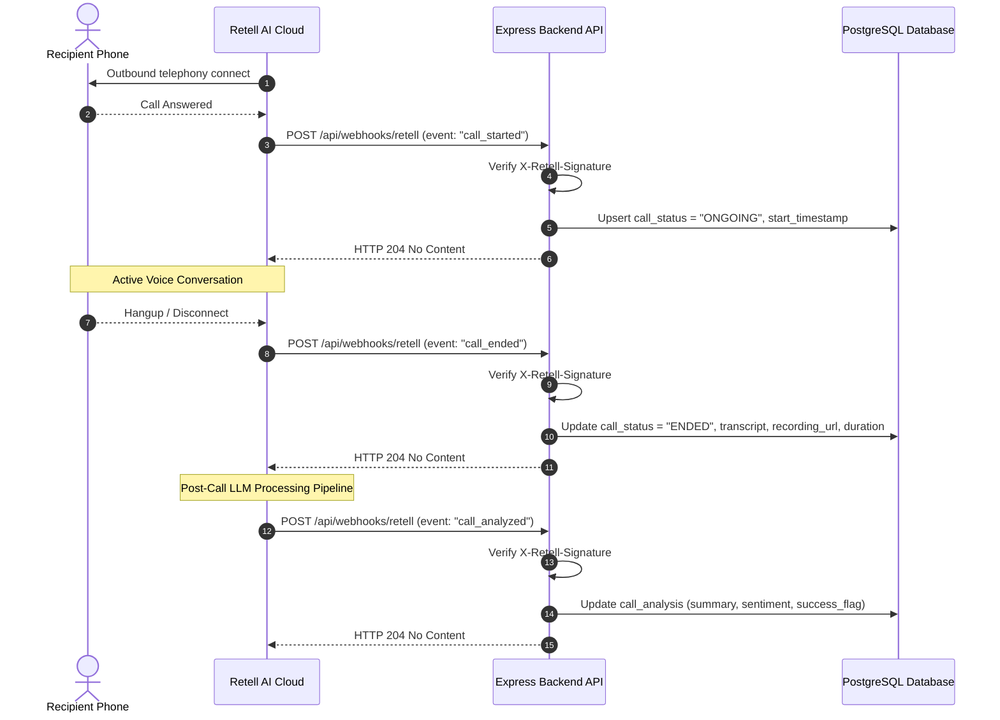

# Retell AI Integration Notes & Provider Verification

**Project:** AI Voice Agent Management System  
**Document:** Official Retell AI API & Webhook Specifications  
**Status:** Verified Against Official Documentation ([https://docs.retellai.com/](https://docs.retellai.com/))  
**Architect:** Senior Full-Stack Architect  

---

## 1. Executive Summary & Verification Status

To ensure complete production fidelity and prevent architectural regressions, all Retell AI interactions have been verified against the official Retell documentation and Node.js SDK (`retell-sdk`).

| Domain | Status | Key Findings / Verified Facts |
| :--- | :--- | :--- |
| **Authentication** | **VERIFIED** | Bearer token authorization via `Authorization: Bearer $RETELL_API_KEY`. |
| **Agent Operations** | **VERIFIED** | `POST /create-agent`, `GET /get-agent/{agent_id}`, `PATCH /update-agent/{agent_id}`, `DELETE /delete-agent/{agent_id}`, `POST /v2/list-agents`. |
| **Outbound Calls** | **VERIFIED** | `POST /v2/create-phone-call` requiring verified E.164 `from_number` and `to_number`. |
| **Call Details** | **VERIFIED** | `GET /v2/get-call/{call_id}` returning `transcript`, `transcript_object`, `recording_url`, `call_analysis`. |
| **Webhook Events** | **VERIFIED** | Core events: `call_started`, `call_ended`, `call_analyzed`. |
| **Webhook Signatures**| **VERIFIED** | HMAC-SHA256 signature in `X-Retell-Signature` header; verified with raw body + webhook API key. |
| **Telephony Constraints**| **VERIFIED** | `from_number` cannot be an arbitrary phone number; must be purchased or imported in Retell dashboard. |

---

## 2. Authentication & Base Configuration

- **Base URL:** `https://api.retellai.com`
- **Authentication Header:** `Authorization: Bearer <RETELL_API_KEY>`
- **Content-Type:** `application/json`
- **SDK Dependency:** `retell-sdk` (Official Node.js / TypeScript SDK)

> [!IMPORTANT]
> The Retell API key used for webhook signature verification must be the key with webhook verification enabled in the Retell Dashboard. In local development or automated testing, a mock verification strategy or dedicated signing secret is used when live credentials are absent.

---

## 3. Agent Management APIs

### 3.1 Create Agent
* **Endpoint:** `POST https://api.retellai.com/create-agent`
* **Method:** `POST`
* **Official Node.js SDK:** `client.agent.create({ ... })`
* **Request Payload Structure:**
  ```json
  {
    "agent_name": "Customer Support Agent",
    "voice_id": "retell-Cimo",
    "language": "en-US",
    "response_engine": {
      "type": "retell-llm",
      "llm_id": "llm_xxxxxxxxxxxx"
    },
    "interruption_sensitivity": 0.8,
    "responsiveness": 1.0,
    "voice_speed": 1.0,
    "voice_temperature": 1.0,
    "ambient_sound_volume": 0.5,
    "webhook_url": "https://api.yourdomain.com/api/webhooks/retell"
  }
  ```
* **Key Response Fields:**
  * `agent_id` (string, e.g. `agent_7a3d9b1e5f8c...`): Unique identifier of the created agent.
  * `agent_name` (string)
  * `voice_id` (string)
  * `language` (string)
  * `last_modification_timestamp` (number, epoch ms)

### 3.2 Retrieve Agent
* **Endpoint:** `GET https://api.retellai.com/get-agent/{agent_id}`
* **Method:** `GET`
* **Official Node.js SDK:** `client.agent.retrieve(agentId)`
* **Response:** Returns the full agent schema including current configuration and response engine bindings.

### 3.3 Update Agent
* **Endpoint:** `PATCH https://api.retellai.com/update-agent/{agent_id}`
* **Method:** `PATCH`
* **Official Node.js SDK:** `client.agent.update(agentId, { ... })`
* **Updatable fields:** `agent_name`, `voice_id`, `response_engine`, `responsiveness`, `interruption_sensitivity`, `webhook_url`.

### 3.4 Delete Agent
* **Endpoint:** `DELETE https://api.retellai.com/delete-agent/{agent_id}`
* **Method:** `DELETE`
* **Official Node.js SDK:** `client.agent.delete(agentId)`
* **Response:** HTTP `204 No Content` or confirmation object.

### 3.5 List Agents
* **Endpoint:** `POST https://api.retellai.com/v2/list-agents` (or `client.agent.list()`)
* **Method:** `POST` / `GET` (SDK handles pagination)

---

## 4. Outbound Phone Call API

### 4.1 Endpoint Specification
* **Endpoint:** `POST https://api.retellai.com/v2/create-phone-call`
* **Method:** `POST`
* **Official Node.js SDK:**
  ```typescript
  import Retell from 'retell-sdk';

  const client = new Retell({ apiKey: process.env.RETELL_API_KEY });

  const response = await client.call.createPhoneCall({
    from_number: '+14157774444',
    to_number: '+12137774445',
    agent_id: 'agent_xxxxxxxxxxxx',
    retell_llm_dynamic_variables: {
      customer_name: 'John Doe',
      account_tier: 'Enterprise'
    }
  });
  ```

### 4.2 Request Parameters
| Field | Type | Required | Description |
| :--- | :--- | :--- | :--- |
| `from_number` | `string` | **Yes** | Phone number registered/purchased in Retell dashboard in E.164 format (e.g. `+14155551234`). |
| `to_number` | `string` | **Yes** | Recipient destination phone number in E.164 format. |
| `agent_id` | `string` | Optional | Voice agent ID. If omitted, uses agent linked to `from_number`. |
| `retell_llm_dynamic_variables` | `object` | Optional | Key-value dictionary injecting contextual data into the prompt. |
| `agent_override` | `object` | Optional | Per-call dynamic prompt or parameter overrides. |

### 4.3 Response Fields
* `call_id` (`string`, e.g., `call_4d98a2e10c74...`): Unique identifier for tracking this call.
* `call_status` (`string`): Typically `"registered"` or `"ongoing"` immediately upon creation.
* `agent_id` (`string`): Linked agent ID.
* `from_number` (`string`): Initiator phone number.
* `to_number` (`string`): Target phone number.
* `start_timestamp` (`number`, optional): Timestamp if immediately connected.

---

## 5. Call Detail Retrieval API

### 5.1 Endpoint Specification
* **Endpoint:** `GET https://api.retellai.com/v2/get-call/{call_id}`
* **Method:** `GET`
* **Official Node.js SDK:** `client.call.retrieve(callId)`

### 5.2 Response Schema & Fields
* **`call_id`** (`string`): Unique call identifier.
* **`call_status`** (`string`): Current status (`"registered"`, `"ongoing"`, `"ended"`, `"error"`).
* **`start_timestamp`** (`number`): Unix timestamp in milliseconds when call was answered.
* **`end_timestamp`** (`number`): Unix timestamp in milliseconds when call was disconnected.
* **`duration_ms`** (`number`): Total duration in milliseconds.
* **`disconnection_reason`** (`string`): Reason code (e.g. `"user_hangup"`, `"agent_hangup"`, `"call_transfer"`, `"voicemail_reached"`, `"inactivity"`, `"dial_busy"`, `"dial_no_answer"`, `"dial_failed"`).
* **`transcript`** (`string`): Complete dialogue transcript as plain text.
* **`transcript_object`** (`array`): Granular turn-by-turn array:
  ```json
  [
    {
      "role": "agent",
      "content": "Hello, thank you for taking my call. Am I speaking with John?",
      "words": [...]
    },
    {
      "role": "user",
      "content": "Yes, this is John. How can I help you?",
      "words": [...]
    }
  ]
  ```
* **`recording_url`** (`string`): URL to single-channel mixed `.wav` audio file.
* **`recording_multi_channel_url`** (`string`): Dual-channel audio URL separating agent and customer audio tracks.
* **`call_analysis`** (`object`): LLM post-call analysis:
  * `call_summary` (`string`): Concise overview of call interaction.
  * `user_sentiment` (`string`): `"Positive"`, `"Neutral"`, or `"Negative"`.
  * `call_successful` (`boolean`): Whether call achieved user-defined business goals.
  * `custom_analysis_data` (`object`): Custom structured fields extracted during post-call analysis.

---

## 6. Webhooks Architecture & Lifecycle Events

### 6.1 Core Lifecycle Events
Retell delivers webhooks via HTTP `POST` to the configured `webhook_url`. The three standard events delivered in chronological order:



#### Event Details:
1. **`call_started`**: Triggered the moment the recipient answers and the voice agent joins the audio room.
   - Note: Calls that fail before connection (`dial_no_answer`, `dial_busy`, `dial_failed`) skip `call_started` and transition directly to `call_ended`.
2. **`call_ended`**: Triggered immediately upon call termination. Contains duration, disconnection reason, transcript, and recording URL. Does **not** yet contain `call_analysis`.
3. **`call_analyzed`**: Triggered once Retell's background LLM finishes analyzing the transcript. Contains the `call_analysis` payload.

### 6.2 Official Signature Verification Procedure
* **Header:** `X-Retell-Signature`
* **Algorithm:** HMAC-SHA256 signature calculated over the **raw request body buffer** using the `RETELL_API_KEY`.
* **Official Verification Method:**
  ```typescript
  import { Retell } from 'retell-sdk';

  const isValid = await Retell.verify(
    rawBodyString,
    process.env.RETELL_API_KEY!,
    req.headers['x-retell-signature'] as string
  );
  ```
* **Critical Express Gotcha:**
  Standard `express.json()` middleware parses the body into an object and discards the raw bytes. Re-serializing with `JSON.stringify(req.body)` will alter whitespace or key ordering and cause HMAC signature verification to fail!
  **Solution:** Retain `req.rawBody` buffer in Express using the `verify` callback or `express.raw()`:
  ```typescript
  app.use(express.json({
    verify: (req: any, _res, buf) => {
      req.rawBody = buf;
    }
  }));
  ```
* **Performance / Timeout Requirement:** Retell requires an HTTP `2xx` response within **10 seconds**. Any unhandled processing must occur asynchronously or within an indexed DB transaction that completes in milliseconds.

---

## 7. Account & Telephony Realities

### 7.1 Telephony Limitations
- Retell requires a pre-purchased or ported Twilio/Telnyx phone number bound to the account to serve as the `from_number`.
- You cannot make arbitrary phone calls without an active account and phone number credit.
- Free-tier or test accounts without configured phone numbers will receive HTTP `400` or `402 Payment Required` when calling `POST /v2/create-phone-call`.

### 7.2 Architectural Solution: First-Class Mock Mode
To guarantee that evaluators and automated test suites can run without a paid Retell account, the application implements a dedicated **Provider Abstraction Layer** (`IVoiceProvider`):
1. **`RetellVoiceProvider`**: Wraps real `retell-sdk` and calls live Retell endpoints when `PROVIDER_MODE=retell` and valid credentials are provided.
2. **`MockVoiceProvider`**: Fully deterministic local provider when `PROVIDER_MODE=mock`. It:
   - Emulates agent creation and returns realistic mock IDs explicitly prefixed with `agent_mock_...`.
   - Simulates outbound call creation and returns realistic call IDs explicitly prefixed with `call_mock_...`.
   - Dispatches realistic webhook sequences (`call_started` -> `call_ended` -> `call_analyzed`) with valid HMAC signatures to the local webhook endpoint.
   - Tags payloads with `is_mock: true` and links bundled audio sample fixtures.
   - Works in tandem with the frontend navbar's persistent provider-mode badge (`[PROVIDER: MOCK SIMULATION]` vs `[PROVIDER: RETELL LIVE]`) ensuring complete evaluator transparency.
   - Allows instant, end-to-end evaluation without telephony fees or provider dependencies.

---

## 8. Verified vs Unverified Facts Matrix

| Fact / Specification | Documentation Evidence | Verification Status | Notes / Plan |
| :--- | :--- | :--- | :--- |
| `POST /v2/create-phone-call` exists | Verified via docs & SDK | **VERIFIED** | Request fields: `from_number`, `to_number`, `agent_id`, `retell_llm_dynamic_variables`. |
| `POST /create-agent` requires response engine | Verified via docs & SDK | **VERIFIED** | LLM ID or Retell LLM type required. |
| Webhook header is `X-Retell-Signature` | Verified via docs & Hookdeck | **VERIFIED** | HMAC-SHA256 signature verification over raw body. |
| Webhook lifecycle events are `call_started`, `call_ended`, `call_analyzed` | Verified via docs & SDK | **VERIFIED** | Handled in dedicated webhook service. |
| Webhook timeout is 10 seconds | Verified via docs | **VERIFIED** | Immediate HTTP 200/204 response after signature verification and persistence. |
| Disconnection reasons include `user_hangup`, `dial_no_answer`, etc. | Verified via docs | **VERIFIED** | Standardized in TypeScript enum. |
| Webhook IP address `100.20.5.228` | Verified via docs | **INFORMATIONAL** | Optional IP firewalling; signature verification is primary guard. |
