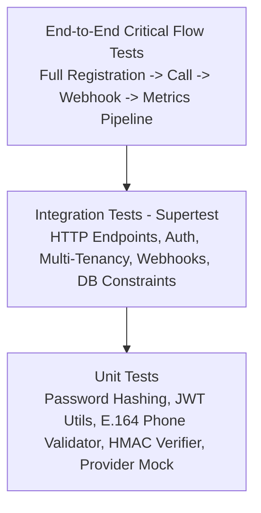
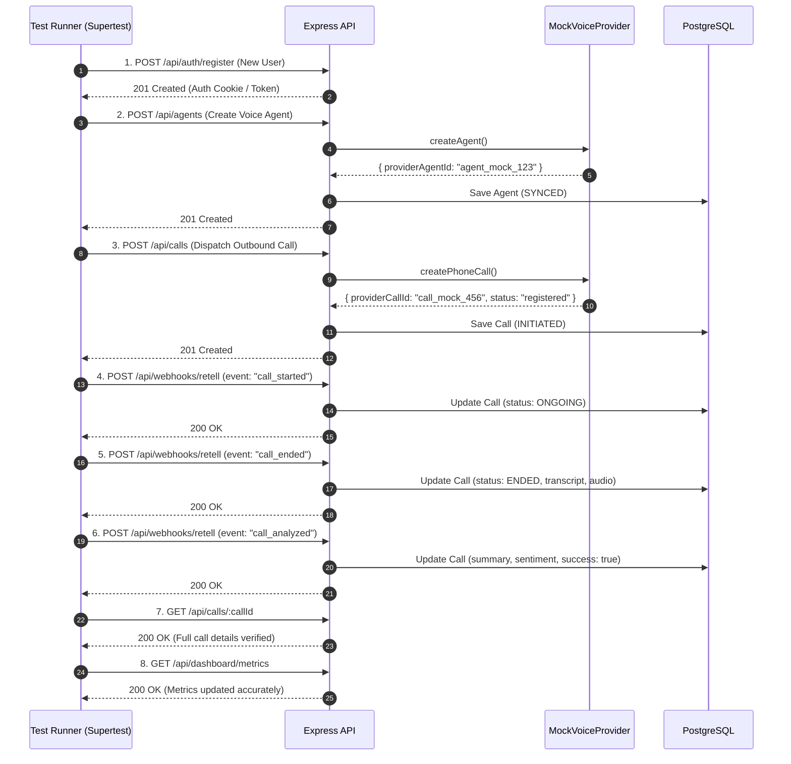

# Comprehensive Quality Assurance & Automated Test Plan

**Project:** AI Voice Agent Management System  
**Organization:** Shiavnski Technologies Developer Assignment  
**Architect:** Senior Full-Stack Architect  
**Test Frameworks:** Vitest / Jest | Supertest | React Testing Library  
**Target Coverage:** >80% Core Business Services & Middlewares  
**Status:** Approved for Implementation  

---

## 1. Test Architecture & Strategy

The testing strategy uses a multi-layered pyramid approach ensuring complete functional correctness, security boundary enforcement, and failure resilience:



### Framework Selection:
- **Backend Test Runner:** `Vitest` or `Jest` with `ts-node` / `esbuild` for TypeScript execution.
- **HTTP Assertion Library:** `Supertest` for testing Express endpoints without spawning external network listeners.
- **Database Test Strategy:** Isolated test schema or transaction rollbacks with SQLite/PostgreSQL test containers, pre-seeded with reproducible fixtures.
- **Provider Mocking:** Zero dependency on external Retell network availability via `MockVoiceProvider` and mocked SDK responses.

---

## 2. Test Suites & Verification Matrix

### 2.1 Suite 1: Authentication & Password Security (`auth.test.ts`)
*Target File:* `backend/tests/integration/auth.test.ts`

| Test Case ID | Test Scenario | Input / Precondition | Expected Result |
| :--- | :--- | :--- | :--- |
| `TEST-AUTH-01` | Successful Registration | Valid email, strong password, full name | HTTP 201 Created; returns user ID and email; password hash is NOT returned |
| `TEST-AUTH-02` | Weak Password Rejection | Password `< 8 chars` or missing number/symbol | HTTP 400 Bad Request with field-level validation error |
| `TEST-AUTH-03` | Duplicate Email Rejection | Attempt to register existing email | HTTP 409 Conflict with clear message |
| `TEST-AUTH-04` | Successful Login | Registered credentials | HTTP 200 OK; returns valid JWT token and sets auth cookie |
| `TEST-AUTH-05` | Invalid Password Login | Valid email, incorrect password | HTTP 401 Unauthorized; generic error message (prevent account enumeration) |
| `TEST-AUTH-06` | Non-Existent User Login | Unregistered email | HTTP 401 Unauthorized |
| `TEST-AUTH-07` | Protected Route Access Without Token | Request to `/api/agents` without Authorization header | HTTP 401 Unauthorized |
| `TEST-AUTH-08` | Protected Route with Expired/Tampered Token | Tampered JWT signature | HTTP 401 Unauthorized |
| `TEST-AUTH-09` | Logout | Active session | HTTP 200 OK; clears auth cookie |

---

### 2.2 Suite 2: Multi-Tenant Data Isolation & Cross-User Security (`security.test.ts`)
*Target File:* `backend/tests/integration/cross_tenant_security.test.ts`

| Test Case ID | Test Scenario | Input / Precondition | Expected Result |
| :--- | :--- | :--- | :--- |
| `TEST-SEC-01` | Cross-User Agent Retrieval | User B attempts `GET /api/agents/:idOfUserA` | HTTP 404 Not Found (or 403 Forbidden); User A's data is never revealed |
| `TEST-SEC-02` | Cross-User Agent Modification | User B attempts `PUT /api/agents/:idOfUserA` | HTTP 404 Not Found; User A's agent remains unmodified |
| `TEST-SEC-03` | Cross-User Agent Deletion | User B attempts `DELETE /api/agents/:idOfUserA` | HTTP 404 Not Found; User A's agent remains active |
| `TEST-SEC-04` | Cross-User Agent Call Hijacking | User B attempts to place outbound call using User A's `agentId` | HTTP 403 Forbidden; call is rejected before provider dispatch |
| `TEST-SEC-05` | Cross-User Call Detail Access | User B attempts `GET /api/calls/:idOfUserA` | HTTP 404 Not Found; transcripts and audio links remain hidden |
| `TEST-SEC-06` | Cross-User Dashboard Isolation | User B requests `/api/dashboard/metrics` | Returns aggregates computed strictly over User B's calls (count = 0) |

---

### 2.3 Suite 3: Agent Management Module (`agent.test.ts`)
*Target File:* `backend/tests/integration/agent.test.ts`

| Test Case ID | Test Scenario | Input / Precondition | Expected Result |
| :--- | :--- | :--- | :--- |
| `TEST-AGENT-01`| Valid Agent Creation | Name, voice, prompt, language | HTTP 201 Created; database contains record with `sync_status = "SYNCED"` and `provider_agent_id` |
| `TEST-AGENT-02`| Agent Creation Validation | Missing prompt or name | HTTP 400 Bad Request with validation breakdown |
| `TEST-AGENT-03`| Provider Failure Handling | Provider API throws 500 on creation | HTTP 502 Bad Gateway or records agent with `sync_status = "SYNC_FAILED"` |
| `TEST-AGENT-04`| List Agents Filter | Authenticated user has 3 agents | HTTP 200 OK; array length = 3; ordered by `created_at DESC` |
| `TEST-AGENT-05`| Update Agent Prompt | Modified system prompt | HTTP 200 OK; database and provider reflect updated prompt |
| `TEST-AGENT-06`| Soft-Delete Agent | Agent with existing calls | HTTP 200 OK; `is_active` becomes `false`; linked calls remain intact |

---

### 2.4 Suite 4: Outbound Call Initiation & Telephony Edge Cases (`call_dispatch.test.ts`)
*Target File:* `backend/tests/integration/call_dispatch.test.ts`

| Test Case ID | Test Scenario | Input / Precondition | Expected Result |
| :--- | :--- | :--- | :--- |
| `TEST-CALL-01` | Valid Outbound Dispatch | Valid agent, valid E.164 phone (`+14155552671`), optional dynamic variables | HTTP 201 Created; returns call record with status `INITIATED` and unique `provider_call_id` |
| `TEST-CALL-02` | Invalid Phone Format | Malformed phone string (`"12345"`, `"abc"`, `"+1"`) | HTTP 400 Bad Request (`Invalid E.164 phone number`) |
| `TEST-CALL-03` | Duplicate Call Debouncing | Same user, recipient, and agent submitted twice within 5 seconds | Second call returns HTTP 200 with existing call record; only 1 provider call dispatched |
| `TEST-CALL-04` | Inactive Agent Rejection | Attempt to place call with soft-deleted agent | HTTP 400 Bad Request (`Cannot initiate call with an inactive agent`) |
| `TEST-CALL-05` | Provider Outbound Timeout | Provider API fails to respond within 8 seconds | HTTP 504 Gateway Timeout or records call as `FAILED` with retry context |
| `TEST-CALL-06` | Provider Error Rejection | Provider returns 400 (e.g. invalid from_number / insufficient funds) | HTTP 422 Unprocessable Entity with human-readable provider explanation |

---

### 2.5 Suite 5: Webhook Ingestion, Resilience & Deduplication (`webhook.test.ts`)
*Target File:* `backend/tests/integration/webhook.test.ts`

| Test Case ID | Test Scenario | Input / Precondition | Expected Result |
| :--- | :--- | :--- | :--- |
| `TEST-WH-01`   | Missing Signature Header | `POST /api/webhooks/retell` without `X-Retell-Signature` | HTTP 401 Unauthorized; event logged as untrusted |
| `TEST-WH-02`   | Invalid HMAC Signature | Tampered raw body or forged signature | HTTP 401 Unauthorized; payload rejected |
| `TEST-WH-03`   | Valid `call_started` Event | Valid signature, payload with `event: "call_started"` | HTTP 200/204; call status transitions to `ONGOING`; `started_at` populated |
| `TEST-WH-04`   | Valid `call_ended` Event | Valid signature, payload with `event: "call_ended"`, transcript, and duration | HTTP 200/204; call status transitions to `ENDED`; duration, transcript, and recording saved |
| `TEST-WH-05`   | Valid `call_analyzed` Event | Valid signature, payload with `call_analysis` (summary, sentiment, success) | HTTP 200/204; `summary`, `sentiment`, and custom analysis data merged |
| `TEST-WH-06`   | Duplicate Webhook Delivery | Identical webhook delivered twice | First returns 200 (processed); second returns 200 (marked `DUPLICATE`); no state corruption |
| `TEST-WH-07`   | Out-of-Order Delivery (`call_ended` before `call_started`) | Network delay causes `call_ended` to arrive first | Call record resolves to `ENDED`; subsequent `call_started` does not regress status |
| `TEST-WH-08`   | Unknown Event Handling | Inbound payload with `event: "agent_sentiment_drift"` | HTTP 200 OK; event saved in `webhook_events` as `IGNORED`; server remains stable |
| `TEST-WH-09`   | Malformed JSON Ingestion | Body contains invalid JSON bytes | Caught by error boundary; returns HTTP 400; does not crash Express server |

---

### 2.6 Suite 6: Call History, Filters, Pagination & Metrics (`analytics.test.ts`)
*Target File:* `backend/tests/integration/analytics.test.ts`

| Test Case ID | Test Scenario | Input / Precondition | Expected Result |
| :--- | :--- | :--- | :--- |
| `TEST-HIST-01` | Pagination Limits | 25 calls seeded; query `?page=1&limit=10` | Returns 10 records, `totalPages: 3`, `totalRecords: 25` |
| `TEST-HIST-02` | Status Filtering | Query `?status=ENDED` | Returns only calls with status `ENDED` |
| `TEST-HIST-03` | Agent Filtering | Query `?agentId=agent_123` | Returns only calls associated with specified agent |
| `TEST-HIST-04` | Date Range Filtering | Query `?startDate=2026-10-01&endDate=2026-10-15` | Returns only calls within specified window |
| `TEST-HIST-05` | Phone Search Query | Query `?search=5671` | Returns calls matching recipient number |
| `TEST-HIST-06` | PII Phone Masking in List | Standard list query | Numbers formatted as `+1 (***) ***-2671` |
| `TEST-HIST-07` | Unmasked Phone in Detail | Single call fetch `GET /api/calls/:id` | Full phone number returned to authenticated owner |
| `TEST-DASH-01` | Dashboard KPI Aggregates | User with 10 completed calls (5 successful) | Total Calls = 10, Success Rate = 50%, Avg Duration computed correctly |

---

### 2.7 Suite 7: Full Critical End-to-End Flow (`call_lifecycle.e2e.test.ts`)
*Target File:* `backend/tests/e2e/call_lifecycle.test.ts`



---

### 2.8 Suite 8: Frontend UI & Component States (`frontend.components.test.tsx`)
*Target File:* `frontend/src/tests/components.test.tsx` (Vitest + React Testing Library)

| Test Case ID | Component / Scenario | Input / Precondition | Expected Result |
| :--- | :--- | :--- | :--- |
| `TEST-FE-01` | Outbound Call Form Validation | User enters invalid phone (`"12345"` or `"abc"`) | Shows inline E.164 error message; primary "Start Call" button remains disabled |
| `TEST-FE-02` | Outbound Call Form Debounce Protection | User clicks "Start Call" with valid inputs | Button immediately transitions to disabled state with loading spinner; blocks subsequent clicks within 5s |
| `TEST-FE-03` | Persistent Provider Mode Badge | App loaded with `VITE_PROVIDER_MODE=mock` vs `retell` | Renders amber badge `[PROVIDER: MOCK SIMULATION]` in mock mode; renders emerald badge `[PROVIDER: RETELL LIVE]` in retell mode |
| `TEST-FE-04` | Audio Player Playback & Scrubbing | Component mounted with `recording_url` prop | Audio player renders with play/pause button, progress scrubber, and timestamp counter; error fallback rendered if audio URL fails |
| `TEST-FE-05` | Loading Skeletons & Empty State Views | Data fetch in flight vs zero items returned | Renders animated shimmer cards during loading; renders empty state card with icon and "Create Agent" / "Make Call" CTA when empty |
| `TEST-FE-06` | Dashboard Interactive Filter Controls | User modifies Date, Agent, or Status dropdown | Triggers re-fetch with active query params; KPI metrics update smoothly without full page reload |

---

## 3. Test Execution Commands & CI/CD Pipeline

Once project dependencies are installed, tests are executed using:

```bash
# 1. Run all backend unit tests
cd backend && npm run test:unit

# 2. Run all backend integration tests (Supertest + DB)
cd backend && npm run test:integration

# 3. Run backend end-to-end critical flow lifecycle test
cd backend && npm run test:e2e

# 4. Run frontend component & UI state tests
cd frontend && npm run test

# 5. Generate complete coverage report
cd backend && npm run test:coverage
```

### Coverage Thresholds:
- **Backend Services:** ≥ 85% line coverage
- **Controllers & Middlewares:** ≥ 80% line coverage
- **Utilities & Validators:** ≥ 95% line coverage
- **Frontend Components:** ≥ 80% component coverage
- **Overall Codebase:** ≥ 80% total coverage
